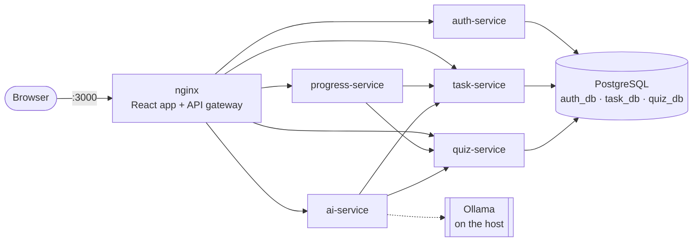

<div align="center">

# 📚 Smart Study Planner

**Plan study tasks, test yourself with quizzes, and track your progress, with a little help from a local AI.**

[](https://github.com/Anishpandey00/ssp-web/actions/workflows/ci.yml)
[](LICENSE)


[Features](#features) · [Architecture](#architecture) · [Quick start](#quick-start) · [Documentation](#documentation) · [Project structure](#project-structure)


</div>

---

Smart Study Planner (SSP) is a cloud-native web application built by **Team D**
as a university project. It implements a Software Requirements Specification
end to end: a React frontend, five Express microservices behind an nginx API
gateway, PostgreSQL with one database per service, Docker Compose for local
deployment, Azure Container Apps for the cloud, and GitHub Actions for CI.

## Features

| | |
|---|---|
| 🔐 **Accounts** | Sign up and log in with bcrypt-hashed passwords and JWT sessions |
| ✅ **Study tasks** | Add, edit, complete and delete tasks with subject, priority and due date |
| 📝 **Quizzes** | Take quizzes with instant feedback; scores are saved |
| 📊 **Progress** | Task completion and quiz score history at a glance |
| ✨ **AI study plan** | Turn a goal like *"Physics exam on Dec 12, weak on optics"* into suggested tasks |
| 💡 **Today's focus** | Personal study tips based on overdue tasks and weakest quiz scores |
| 🛠️ **Admin panel** | Manage quizzes, questions and admin rights |
| 🛡️ **Resilient** | Health checks, automatic restarts, and partial answers when a service is down |

The AI features run on [Ollama](https://ollama.com) on your own machine: free,
private and with no API key. If it is off, the rest of the app works normally.

## Architecture



- **Database per service**: Auth, Task and Quiz each own their database; Progress and AI have none.
- **Token checked everywhere**: every service verifies the JWT itself with a shared secret.
- **Network segmentation**: the database sits on an internal Docker network with no published port.

Read more in the [architecture guide](docs/design/architecture.md).

## Tech stack

| Layer | Technology |
|---|---|
| Frontend | React 18, React Router, Vite |
| Backend | Node.js 22, Express, five microservices |
| Data | PostgreSQL 16 |
| AI | Ollama with `qwen2.5:7b` (configurable) |
| Gateway | nginx |
| DevOps | Docker, Docker Compose, Azure Container Apps, GitHub Actions |
| Testing | `node:test` |

## Quick start

Requires [Docker](https://docs.docker.com/get-docker/) with Compose.

```bash
git clone https://github.com/Anishpandey00/ssp-web.git
cd ssp-web
cp .env.example .env        # then set DB_PASSWORD and a long random JWT_SECRET
docker compose up -d --build --wait
```

Open **http://localhost:3000** and click **Sign up**.

For the AI features, install Ollama and pull the model once:

```bash
ollama pull qwen2.5:7b
```

Running without Docker, the admin account, data migration and troubleshooting
are covered in [Running locally](docs/deployment/local.md).

## Development

```bash
npm ci && npm ci --prefix services
npm run server     # five services on ports 4001–4005
npm run dev        # Vite on http://localhost:5173
```

| Command | Purpose |
|---|---|
| `npm test` | Unit tests |
| `npm run build` | Production frontend build into `dist/` |
| `docker compose config --quiet` | Validate the Compose file |

The same checks run in GitHub Actions on every push and pull request.

## Documentation

| | |
|---|---|
| **Planning** | [Project plan](docs/planning/project-plan.md) · [Requirements & traceability](docs/planning/requirements.md) · [Team & RACI](docs/planning/team-and-raci.md) |
| **Design** | [Architecture](docs/design/architecture.md) · [Database](docs/design/database.md) · [API reference](docs/design/api.md) · [UI design](docs/design/ui.md) |
| **Implementation** | [Backend](docs/implementation/backend.md) · [Frontend](docs/implementation/frontend.md) · [Testing](docs/implementation/testing.md) |
| **Deployment** | [Running locally](docs/deployment/local.md) · [Azure](docs/deployment/azure.md) · [Container network](docs/deployment/network.md) |
| **Deliverables** | [Reports and presentations](docs/README.md#deliverables) |

## Project structure

```text
ssp-web/
├── .github/            CI workflow, issue and pull request templates, Dependabot
├── deploy/azure/       Azure Container Apps deployment script
├── docker/             frontend Dockerfiles and nginx configs (local and Azure)
├── docs/               planning, design, implementation, deployment, deliverables
├── public/             static images
├── scripts/            network demo, data migration
├── services/           the five microservices
│   ├── shared/         Express setup, JWT checks, database pool, due-date rule
│   ├── auth-service/   sign up, log in, admin users      → auth_db
│   ├── task-service/   study tasks                       → task_db
│   ├── quiz-service/   quizzes, questions, scores        → quiz_db
│   ├── progress-service/  dashboard numbers from Task + Quiz
│   ├── ai-service/     AI study plan and tips via Ollama
│   └── Dockerfile      one image per service (--build-arg SERVICE)
├── src/                React app: pages, components, context, API client, styles
├── tests/              unit tests
├── docker-compose.yml  the seven containers and their networks
├── .env.example        configuration template
└── package.json        frontend dependencies and scripts
```

## Project status

All SRS functional requirements are implemented, and the local deployment runs
the full microservices design. Azure still runs the earlier three-container
version; moving it to the microservices is the next step
([details](docs/deployment/azure.md)).

## Contributing

See [CONTRIBUTING.md](CONTRIBUTING.md). Report security issues as described in
[SECURITY.md](SECURITY.md).

## License

[MIT](LICENSE) © 2026 Team D
