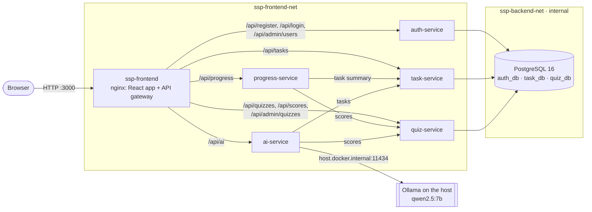
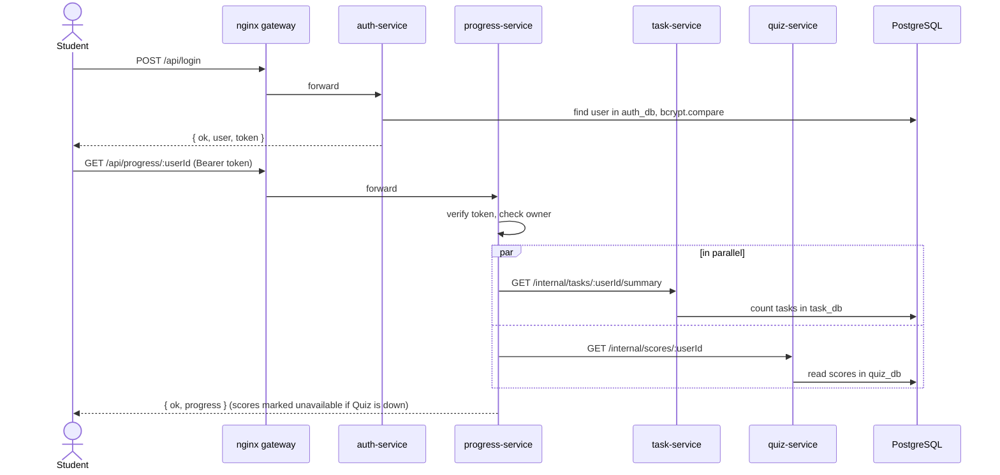

# Architecture

Smart Study Planner is a React single-page app in front of five Express
microservices. One nginx container serves the app and acts as the API gateway.
PostgreSQL holds one database per service that stores data.

## System overview

## Components

| Component | Responsibility | Data |
|---|---|---|
| **ssp-frontend** (nginx) | Serves the React build; routes each `/api/...` path to the service that owns it; the only published port | — |
| **auth-service** | Sign up, log in, admin user management; issues the JWT | `auth_db`: users |
| **task-service** | Study task CRUD and the due-date rule | `task_db`: tasks |
| **quiz-service** | Quizzes, questions, scores, admin quiz editing; loads starter quizzes | `quiz_db`: quizzes, questions, scores |
| **progress-service** | Dashboard and Progress numbers, combined from Task and Quiz | none |
| **ai-service** | AI study plan and study tips through Ollama | none (in-memory cache only) |
| **ssp-db** (PostgreSQL 16) | One server, one database per data-owning service | volume `ssp-db-data` |

## Key design decisions

| Decision | Why |
|---|---|
| **Database per service** on one PostgreSQL server | Each service owns its data and can change its schema alone; one server keeps the local setup light. No foreign keys cross service boundaries. |
| **Stateless JWT checked by every service** | A shared `JWT_SECRET` lets each service verify the token itself, so the Auth service is not on every request's path. |
| **nginx as the API gateway** | One origin for the browser (no CORS issues), path-based routing, and services stay unpublished. nginx re-resolves service names, so it keeps running while a service restarts. |
| **Two Docker networks** | The database sits on an `internal` network that only Auth, Task and Quiz join. The gateway, Progress and AI services cannot reach it at all. |
| **Graceful degradation** | Progress calls Task and Quiz in parallel with a 3 s timeout; if Quiz is down it still returns task numbers. AI tips fall back to rule-based tips when Ollama is off. |
| **One image per service** | `services/Dockerfile` copies the shared code and only the chosen service folder (`--build-arg SERVICE=...`). |
| **Local AI with Ollama** | Free, private and needs no API key. Facts are worked out in code and the model only phrases them, so it cannot invent tasks or scores. |
| **Ordered start-up** | Compose health checks start the database, then the data services, then Progress, then the gateway. |

## Request flow: logging in and loading progress

More detail: [database design](database.md), [API reference](api.md),
[UI design](ui.md), [network guide](../deployment/network.md).
