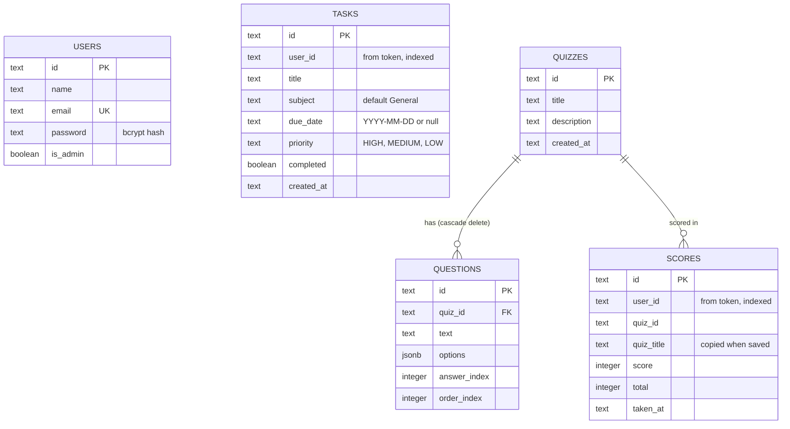

# Database design

One PostgreSQL 16 server holds a separate database for each service that stores
data. Each service creates its own database and tables on start-up
(`CREATE ... IF NOT EXISTS`), so no migration tool is needed for a new install.

Users live only in `auth_db`. Other services store the `user_id` taken from the
verified login token, so there are no foreign keys between databases.

| Database | Owner | Tables |
|---|---|---|
| `auth_db` | auth-service | `users` |
| `task_db` | task-service | `tasks` (index on `user_id`) |
| `quiz_db` | quiz-service | `quizzes`, `questions`, `scores` (index on `scores.user_id`) |

## Notes

- IDs are UUIDs generated by the services (starter quizzes keep short fixed IDs such as `q-web`).
- A score keeps a copy of the quiz title, so the history still reads correctly
  after a quiz is renamed or deleted.
- The score's `total` comes from the database's question count, never from the request.
- All queries use parameters (`$1, $2, …`); no SQL is built from user input.
- Data persists in the `ssp-db-data` Docker volume. To move data from the
  pre-microservices single database, run `bash scripts/migrate-to-microservices.sh --yes`.
