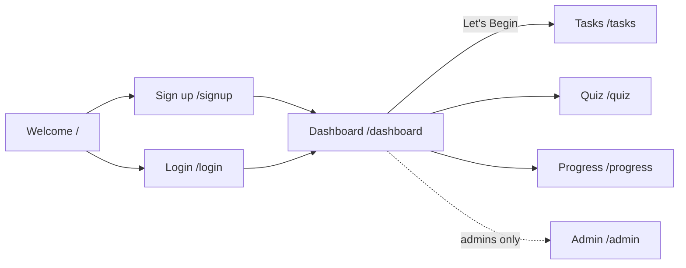

# UI design

The interface is a single-page React app. Mockups for every page are in
[`SSP_UI_Mockup_All_Pages.pptx`](../presentations/SSP_UI_Mockup_All_Pages.pptx),
with an alternative direction in
[`SSP_UI_Mockup_Alternative.pptx`](../presentations/SSP_UI_Mockup_Alternative.pptx).

## Pages and navigation

| Page | Route | Access | Purpose |
|---|---|---|---|
| Welcome | `/` | Public | Introduction with links to log in or sign up |
| Login | `/login` | Public | Email and password; error banner on failure |
| Sign up | `/signup` | Public | Name, email, password (6+ characters) |
| Dashboard | `/dashboard` | Student | Greeting, task and quiz summary, **Let's Begin**, **Today's focus** AI tips |
| Tasks | `/tasks` | Student | Add, edit, complete and delete tasks; All / Pending / Completed filters; **Plan my study with AI** |
| Quiz | `/quiz` | Student | Pick a quiz, answer with instant feedback, final score |
| Progress | `/progress` | Student | Task completion and quiz score history |
| Admin | `/admin` | Admin | Manage quizzes, questions and admin rights |

`ProtectedRoute` sends visitors without a valid session to the login page and
non-admins away from `/admin`. Unknown routes go back to `/`.

## Visual language

Design tokens are CSS custom properties in `src/styles/index.css`:

| Token | Value | Use |
|---|---|---|
| `--paper` / `--paper-2` | `#ddd9f7` / `#cfc9f0` | Page background |
| `--card` | `#ffffff` | Cards and panels |
| `--ink` / `--ink-soft` | `#1d1b2e` / `#5b5775` | Text and secondary text |
| `--accent` / `--accent-dark` | `#30762d` / `#245a22` | Primary actions, success |
| `--gold` | `#c89b3c` | Highlights |
| `--radius` | `20px` | Card corners |
| `--body` | System font stack | All text |

## Interaction principles

- **Feedback on every action:** toasts (`ToastContext`) confirm saves, deletes and errors.
- **Prevent mistakes early:** the task form checks the title and due-date range
  before sending; the API repeats the same checks.
- **Graceful degradation:** if a service or the AI model is unavailable, only
  that part of the page shows a message; the rest keeps working.
- **Review before saving:** AI suggestions are shown as a checklist; nothing is
  saved until the student adds the ones they want.
- **Responsive:** layouts adapt from phone width (320px) to desktop.
